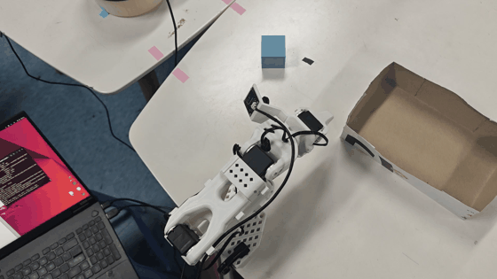
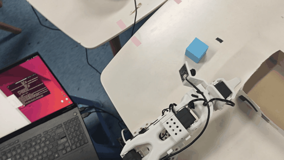
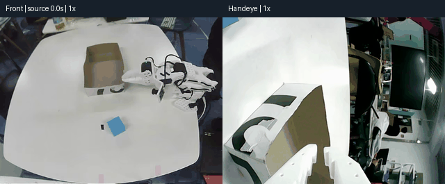
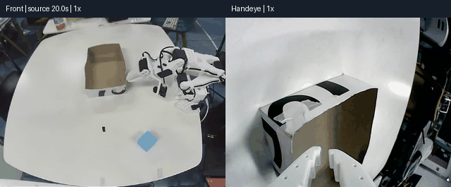
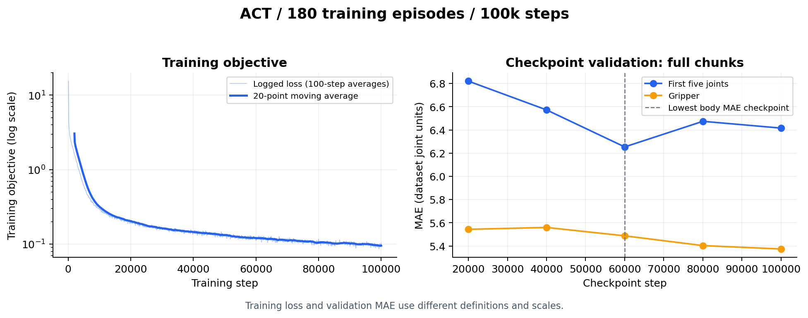
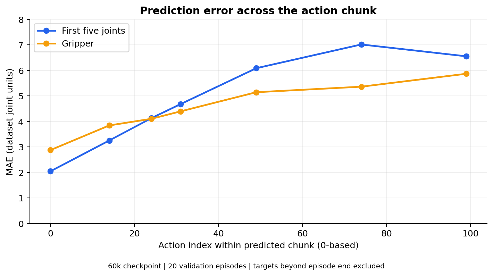
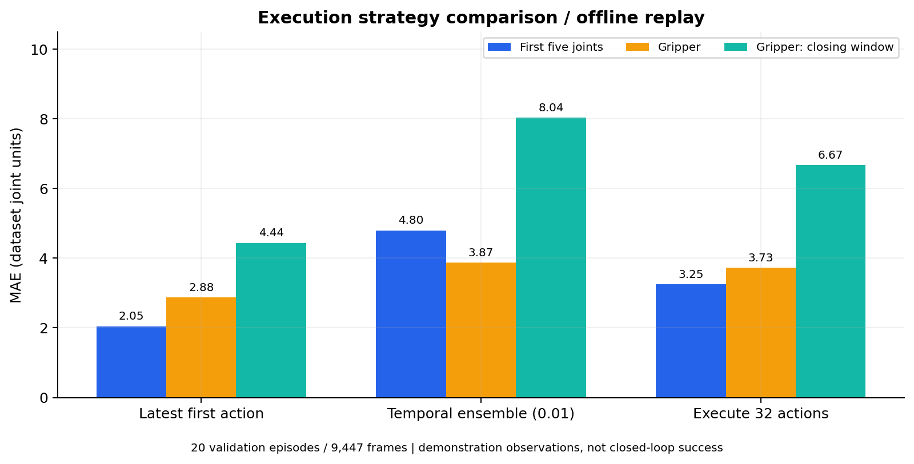
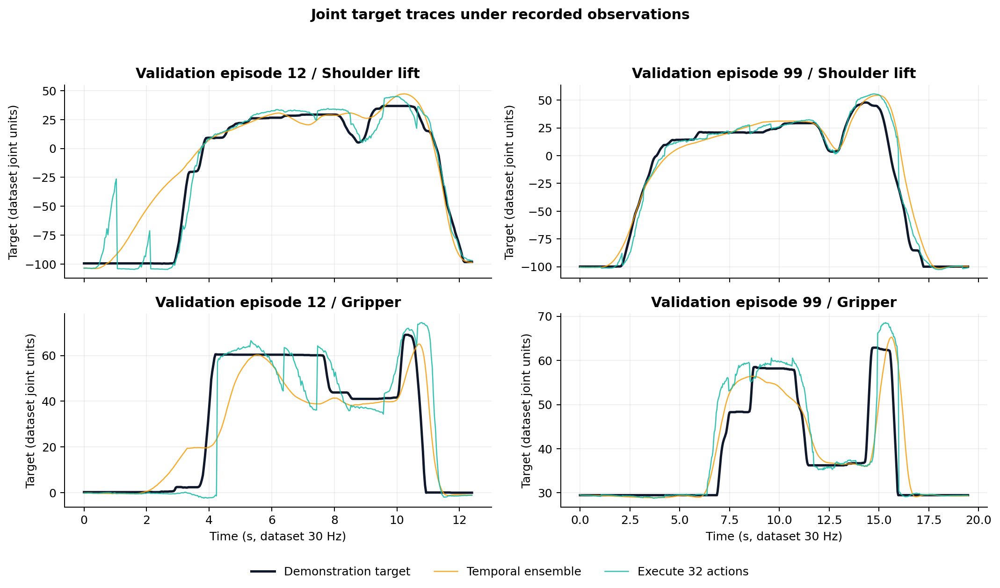
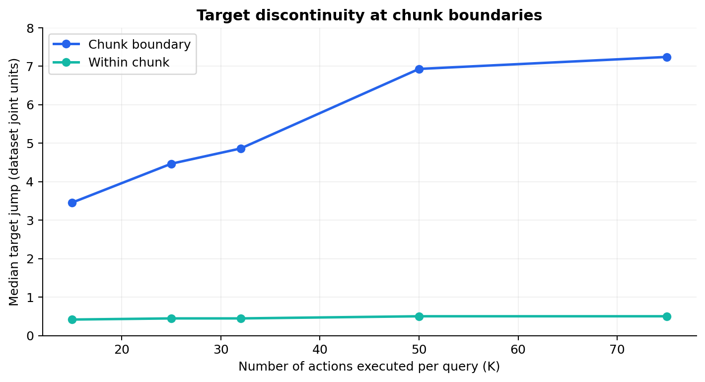

# 在 SO-ARM101 上复现 ACT：蓝色方块抓取与放置

基于 [LeRobot](https://github.com/huggingface/lerobot)，在 SO-ARM101 主从机械臂上完成 Action Chunking Transformer（ACT）的示范采集、模型训练和真机部署。任务为**抓起桌面上的蓝色方块，将其放入纸盒**。

实验从 50 条示范起步，扩充至 200 条，按 episode 划分为 180 条训练、20 条验证，并对比时间集成与固定执行步数，分析抓取偏差、动作连续性和远期动作预测误差。

## 真机演示与失败对照

### 成功：接近、抓取并放入纸盒




### 位置变化后未能抓起




<details>
<summary>查看已有的另外两段成功抓放</summary>






</details>

五条原录像的筛选说明、人工介入位置与片段索引见[视频评阅记录](docs/results/视频评阅记录.md)。展示片段用于说明可观察行为，未据此计算成功率；位置泛化不足是待验证解释，需固定模型、校准与起始条件后做分区测试。

## 结果概览

| 项目 | 已有结果 |
|---|---|
| 真机执行 | 已保存自主抓取入盒、位置变化后失败及近景抓空片段 |
| 数据规模 | 200 条示范；180 条训练、20 条验证 |
| 训练进度 | 完成 100,000 步；已有验证指标最优检查点为 60,000 步 |
| 位置变化 | 局部位置能够完成任务，其他位置仍有抓取偏差 |
| 策略对照 | 已记录固定执行步数与时间集成的实机表现及离线指标 |
| 真机成功率 | 尚未完成统一位置、起始姿态与校准条件下的逐次计分 |

### 离线回放对照

固定 60,000 步检查点，回放 20 条验证示范，共 9,447 帧。每次输入示范真实关节状态与双相机图像，潜变量取 `z=0`。

| 模式 | 前五关节 MAE | 夹爪 MAE | 闭合窗口夹爪 MAE |
|---|---:|---:|---:|
| 每帧最新预测第一步，无融合 | 2.05 | 2.88 | 4.44 |
| 时间集成，系数 0.01 | 4.80 | 3.87 | 8.04 |
| 连续执行 32 步，无融合 | 3.25 | 3.73 | 6.67 |


## 实验曲线

### 训练与检查点验证



左图来自 1,000 条训练日志记录，细线为每 100 步记录的平均损失，粗线为 20 个记录点的滑动平均。右图来自五个检查点的验证记录，每条验证示范均匀抽取 10 个观测，评估完整动作块并排除末尾填充。前五关节 MAE 在 60,000 步最低，夹爪 MAE 则在 100,000 步更低。

### 动作块中的预测距离与误差



固定 60,000 步检查点，在完整验证回放上比较动作块中不同索引的预测误差；超出示范末尾的目标不参与统计。远期预测误差整体高于最新一步，曲线连接已有七个评估索引。

### 执行策略对照



20 条验证示范、9,447 帧。闭合窗口按夹爪目标变化规则近似定位。

### 关节目标轨迹



展示验证示范 12 与 99 的肩部抬升和夹爪目标：黑线为示范目标，橙线为时间集成，青线为连续执行 32 步。输入来自录制观测，图中曲线是预测目标，不是机械臂实际跟随轨迹。

<details>
<summary>查看换块跳变对照</summary>



跳变为相邻目标在前五个关节上的最大绝对变化，再取中位数。换块处跳变明显大于块内


## 复现范围

算法来自论文 [Learning Fine-Grained Bimanual Manipulation with Low-Cost Hardware](https://huggingface.co/papers/2304.13705)。本项目保留动作分块、Transformer 与 CVAE 训练机制，使用单臂抓放任务进行工程复现。

| 维度 | ACT 原论文 | 本项目 |
|---|---|---|
| 平台 | 双臂 ALOHA | 单台 SO-ARM101 从臂，主臂采集示范 |
| 视觉 | 多视角观测 | 手眼 `handeye` + 前方 `front` |
| 任务 | 多种精细双臂操作 | 单臂蓝色方块抓取入盒 |
| 实现 | ACT 参考代码 | 固定版本 LeRobot + SO-101 适配补丁 |
| 评估 | 任务完成率 | 真机抓放、预测误差、目标连续性与失败分析 |

## 实验流程

1. 校准主从臂，检查相机与关节映射。
2. 遥操作采集示范，同步保存双相机图像、关节状态与动作。
3. 整理 200 条示范，按 episode 划分 180 条训练与 20 条验证。
4. 训练 ACT，以验证指标比较检查点。
5. 真机部署并记录视频与动作日志。

## 平台与数据

| 项目 | 配置 |
|---|---|
| 机器人 | SO-ARM101 leader / follower |
| 相机 | `handeye`、`front`，RGB，640 × 480 |
| 数据集频率 | 30 Hz；实际部署控制频率单独测量 |
| 状态与动作 | 6 维关节位置，包含夹爪 |
| 视觉主干 | ImageNet 预训练 ResNet-18 |
| 数据格式 | LeRobot v2.1 |
| 数据目录 | `data/datasets/blue_cube_200`，本地保存 |

示范包含接近、抓取、搬运与入盒过程。数据覆盖与录制批次作为独立因素分析；起始姿态和夹爪校准随评估配置记录。

## 训练

180 条训练示范的配置见 [act_blue_cube_180train.json](configs/act_blue_cube_180train.json)，数据划分见 [blue_cube_200_split.json](configs/blue_cube_200_split.json)。

| 参数 | 值 |
|---|---|
| 动作块长度 | 100 |
| 默认时间集成 | 每步推理，系数 0.01 |
| Transformer | 隐维 512，8 头，4 层 Encoder / 1 层 Decoder，FFN 3200 |
| CVAE | 潜变量 32 维，KL 权重 10 |
| AdamW | 学习率 1e-5，权重衰减 1e-4 |
| 训练步数 / batch size | 100,000 / 4 |
| 随机种子 / 保存间隔 | 1000 / 20,000 步 |

20 条验证示范参与检查点选择，离线诊断复用了该集合。完整训练终点与用于部署、诊断的 60,000 步检查点分别记录。

## 失败现象与分析

- **位置变化后的抓取偏差：** 局部位置能完成任务，其他位置仍有抓空；后续按桌面九宫格、距离与朝向分组计分。
- **短执行段下停滞：** 早期 K=15、25 的部分真机运行出现初始位姿反复运动，需统一起始条件、校准和模型后重测。
- **换块跳变：** 离线 K=32 的换块跳变中位数为 4.86，块内为 0.45，预测目标本身存在不连续。
- **平滑性与精度：** 时间集成减小目标跳变，但远期预测误差参与融合，闭合窗口夹爪误差增大。

详细记录：[执行步数日志](docs/results/K执行步数日志对比.md)、[200 条数据模型诊断](docs/results/200条数据模型离线诊断.md)、[早期模型留出集验证](docs/results/新模型留出集离线验证.md)。

## 复现入口

完整流程见 [docs/reproduction.md](docs/reproduction.md)。以下保留通用基线的安装、采集、训练与部署命令；200 条示范实验使用上文独立配置、数据划分及对应检查点。

## 仓库结构

```text
.
├── configs/
│   └── act_so101.json          # ACT 超参数、数据路径和训练参数
├── data/
│   └── datasets/               # 本地 LeRobot 数据集，不提交到 Git
├── docs/
│   ├── reproduction.md         # 数据采集、训练与实机评估流程
│   └── results/                # 实验记录和结果表
├── outputs/                    # 日志、检查点和实机评估数据，不提交到 Git
├── patches/
│   └── 0001-so101-adapter.patch
├── scripts/
│   ├── bootstrap.sh            # 固定 LeRobot 版本并应用适配补丁
│   └── smoke_act.py            # 合成数据上的 ACT 前向、反向和推理测试
├── src/
│   ├── lerobot/                # 本地上游源码，忽略提交
│   └── soarm101_act/           # 配置校验和命令构造
└── tests/                      # 配置与命令单元测试
```

## 固定版本

| 组件 | 版本或提交 |
|---|---|
| LeRobot | `0.3.4` |
| 上游提交 | `882c80d446a63a44868c67ae535467af32ce0e80` |
| Python | 3.10 或更高 |
| 训练设备 | 支持 CUDA 的 NVIDIA GPU；CPU 可运行烟雾测试 |
| 数据集格式 | LeRobot `v2.1` |
| 机器人适配 | `so101_follower`、`so101_leader`，补丁同时包含双 SO-101 支持 |

`scripts/bootstrap.sh` 负责检出固定提交并应用 `patches/0001-so101-adapter.patch`。上游源码、数据集、检查点和课程资料均不进入 Git。

## 安装

建议在独立 Python 环境中执行：

```bash
python3 -m venv .venv
source .venv/bin/activate
python3 -m pip install --upgrade pip
bash scripts/bootstrap.sh --install
```

仅准备源码、不安装依赖时执行：

```bash
bash scripts/bootstrap.sh
```

安装完成后检查环境：

```bash
python3 -m soarm101_act.cli check --config configs/act_so101.json
```

数据集尚不存在时，`check` 会给出版本、路径和 CUDA 参数的检查结果；完成数据采集后，该命令还会检查 `meta/info.json`。

## 数据采集

串口和相机参数通过命令行或环境变量提供：

```bash
export SOARM_FOLLOWER_PORT=/dev/ttyACM0
export SOARM_LEADER_PORT=/dev/ttyACM1
export SOARM_CAMERAS_JSON='{"front":{"type":"opencv","index_or_path":"/dev/video0","width":640,"height":480,"fps":30}}'

python3 -m soarm101_act.cli record \
  --config configs/act_so101.json \
  --episodes 50
```

采集前需完成主从臂 ID 设置、从臂校准和相机检查。数据默认保存在本地，不自动上传 Hugging Face Hub。详细操作见 [docs/reproduction.md](docs/reproduction.md)。

## 训练

```bash
python3 -m soarm101_act.cli train \
  --config configs/act_so101.json \
  --device cuda \
  --batch-size 8
```

命令会生成实际使用的 LeRobot 训练配置：

```text
outputs/configs/act_so101_train.json
```

检查点保存在：

```text
outputs/train/act_so101/checkpoints/
```

恢复训练时使用 LeRobot 的原始配置入口：

```bash
lerobot-train \
  --config_path=outputs/train/act_so101/checkpoints/last/pretrained_model/train_config.json \
  --resume=true
```


## 实机评估

在机械臂周围预留动作范围，首次运行使用较低的 `max_relative_target`。训练完成后执行：

```bash
export SOARM_FOLLOWER_PORT=/dev/ttyACM0
export SOARM_CAMERAS_JSON='{"front":{"type":"opencv","index_or_path":"/dev/video0","width":640,"height":480,"fps":30}}'

python3 -m soarm101_act.cli rollout \
  --config configs/act_so101.json \
  --policy-path outputs/train/act_so101/checkpoints/last/pretrained_model \
  --episodes 10
```

评估数据默认写入 `data/datasets/so101_eval`。成功率和视频文件记录到 `docs/results/`，并保留对应的有效配置和检查点提交号。

## 许可证

本项目以 Apache License 2.0 发布。LeRobot 与 ACT 参考实现分别遵循其上游许可证。
