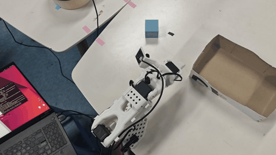
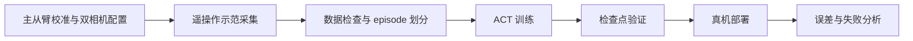
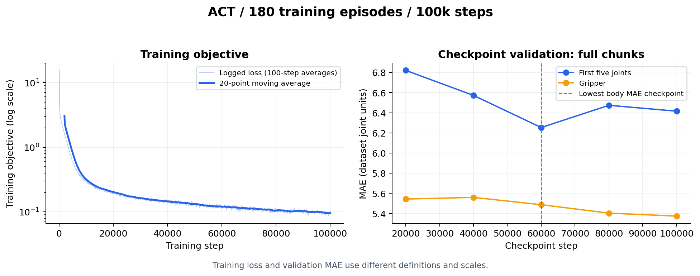
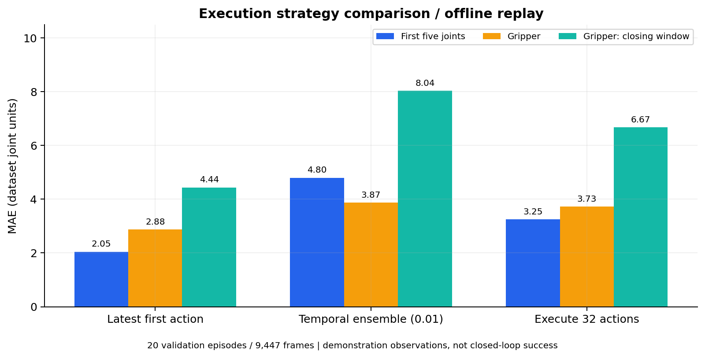
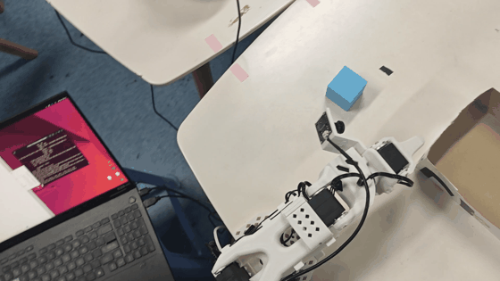
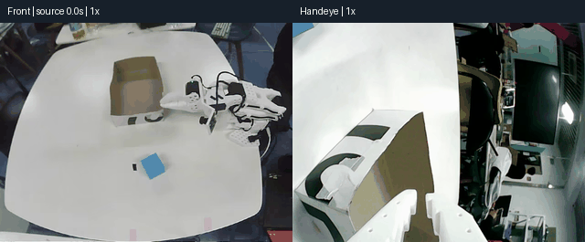
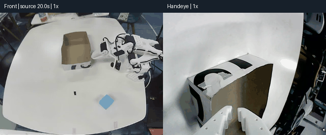

# SO-ARM101 ACT 模仿学习：从遥操作数据采集到真机部署评测

基于 [LeRobot](https://github.com/huggingface/lerobot) 与 SO-ARM101 主从机械臂，构建蓝色方块抓取入盒任务的模仿学习流程，覆盖双相机遥操作示范采集、数据划分、ACT 训练、检查点验证及真机部署。实验将示范扩充至 **200 条**，完成 **100,000 步训练**，并结合真机视频和离线回放分析执行策略、抓取偏差与动作连续性。



## 全流程总览



| 阶段 | 方法与产物 | 实现或实验依据 |
|---|---|---|
| 硬件准备 | 主从臂校准；front + handeye 双视角配置 | [硬件与复现步骤](docs/reproduction.md) |
| 数据采集 | 遥操作录制图像、状态与动作；支持续录和终端控制 | [采集脚本](scripts/record_cube_50.sh)、[终端按键](scripts/record_with_terminal_keys.py) |
| 数据整理 | 200 条示范，180 条训练 / 20 条验证 | [episode 划分](configs/blue_cube_200_split.json) |
| 模型训练 | ACT，batch size 4，训练 100k 步 | [主实验配置](configs/act_blue_cube_180train.json)、[训练日志数据](docs/results/chart_data/training_metrics.csv) |
| 检查点选择 | 比较五个检查点的完整动作块误差，选择前五关节 MAE 最低的 60k | [验证记录](docs/results/chart_data/validation.jsonl) |
| 部署评测 | 真机抓放；时间集成与固定执行步数对照 | [视频评阅](docs/results/视频评阅记录.md)、[执行步数记录](docs/results/K执行步数日志对比.md) |
| 诊断迭代 | 20 条验证示范、9,447 帧离线回放；分析预测偏差与连续性 | [离线诊断](docs/results/200条数据模型离线诊断.md)、[归档指标](docs/results/chart_data/evaluation_summary.json) |

## 项目工程工作

- **采集工具：** 50 条示范采集脚本根据已保存 episode 数计算剩余数量，逐条检查数据文件与视频是否存在且非空；终端按键支持进入下一阶段、重录与停止。
- **硬件与版本适配：** 固定 LeRobot 提交，通过 [SO-101 适配补丁](patches/0001-so101-adapter.patch) 和 [OpenCV FOURCC 补丁](patches/0002-opencv-fourcc.patch) 配置机器人与相机，由 [bootstrap.sh](scripts/bootstrap.sh) 检出并应用。
- **配置与运行入口：** [配置模块](src/soarm101_act/config.py) 校验 ACT 参数约束并生成训练配置；[CLI](src/soarm101_act/cli.py) 封装环境检查、采集、训练及部署命令。
- **实验分析：** 保存训练与验证指标、离线策略对照及视频索引，通过 [绘图脚本](scripts/plot_readme_results.py) 从归档数据生成曲线。

ACT 的动作分块、Transformer 与 CVAE 算法实现基于 LeRobot；任务采用单台 SO-ARM101 从臂，由主臂采集示范。算法来源见 [ACT 论文](https://arxiv.org/abs/2304.13705)。

## 数据采集与整理

| 项目 | 主实验配置 |
|---|---|
| 任务 | 接近蓝色方块、抓取、搬运、放入纸盒 |
| 机器人 | SO-ARM101 leader / follower |
| 相机 | front 场景相机 + handeye 手眼相机；RGB，640 × 480 |
| 数据频率 | 30 Hz |
| 状态与动作 | 6 维关节位置，包含夹爪 |
| 数据格式与位置 | LeRobot v2.1；本地 `data/datasets/blue_cube_200` |
| episode 划分 | 180 条训练、20 条验证；seed 1000 |

实验从 50 条示范起步，随后扩充至 200 条。划分按 episode 进行，验证集包含原始批次 8 条和新增批次 12 条，编号见 [划分文件](configs/blue_cube_200_split.json)。

训练时将划分文件的 `train` 编号写入 LeRobot 有效配置的 `dataset.episodes`；验证使用 `validation` 编号。项目的 `train` 封装生成基础配置，主实验划分通过 [复现文档中的配置生成步骤](docs/reproduction.md#主实验200-条示范的训练与部署) 显式写入。诊断记录核对了历史检查点训练编号与划分文件的一致性。

## 模型训练与检查点选择

主实验配置见 [act_blue_cube_180train.json](configs/act_blue_cube_180train.json)。

| 参数 | 值 |
|---|---|
| 视觉主干 | ImageNet 预训练 ResNet-18 |
| 动作块长度 | 100 |
| Transformer | 隐维 512，8 头；4 层 Encoder / 1 层 Decoder；FFN 3200 |
| CVAE | 潜变量 32 维，KL 权重 10 |
| AdamW | 学习率 1e-5，权重衰减 1e-4 |
| 训练步数 / batch size | 100,000 / 4 |
| 随机种子 / 保存间隔 | 1000 / 20,000 步 |
| 默认执行策略 | 每步推理，时间集成系数 0.01 |



左图展示 1,000 条训练损失记录及 20 点滑动平均。右图比较五个检查点：每条验证示范均匀抽取 10 个观测，推理取 `z=0`，评估完整动作块并排除末尾填充，共 16,784 个有效动作目标。

60k 检查点的前五关节 MAE 为 **6.254**，在五个检查点中最低；夹爪 MAE 为 **5.488**。100k 检查点对应为 6.416 和 5.374。检查点选择采用前五关节 MAE，20 条验证示范同时用于后续离线诊断。指标单位为数据集归一化关节位置，定义与数值见 [验证记录](docs/results/chart_data/validation.jsonl)。

## 真机部署与评测

部署数据流：**双相机 RGB + 当前 6 维关节状态 → ACT 预测 100 步动作块 → 时间集成或动作队列 → 关节位置目标 → 从臂执行 → 下一次观测**。

离线诊断采用原始 `060000/pretrained_model` 检查点。历史真机部署版本为 `act_blue_cube_180train_best60k_gripper1614`，学习权重与原始检查点逐张量一致，六个夹爪归一化统计缓冲区按校准映射调整；模型对应关系见 [诊断记录](docs/results/200条数据模型离线诊断.md)。部署需匹配训练相机键、机器人校准与夹爪统计。

### 离线策略对照

固定原始 60k 检查点，在 20 条验证示范、9,447 帧上回放。每帧输入录制的真实关节状态和双相机图像，潜变量取 `z=0`。MAE 为预测目标相对示范动作的绝对误差，单位为**数据集归一化关节位置**，与网络使用的 z-score 标准化区分。

| 模式 | 前五关节 MAE | 夹爪 MAE | 闭合窗口夹爪 MAE |
|---|---:|---:|---:|
| 每帧最新预测第一步，无融合 | 2.05 | 2.88 | 4.44 |
| 时间集成，系数 0.01 | 4.80 | 3.87 | 8.04 |
| 连续执行 32 步，无融合 | 3.25 | 3.73 | 6.67 |



闭合窗口按夹爪目标变化规则定位，合计 620 帧。时间集成的全程目标跳变中位数为 0.47，最新一步模式为 0.67；时间集成的闭合窗口夹爪误差更大。上述回放比较预测偏差与连续性，真机任务表现通过视频与逐次执行记录分析。完整指标、预测距离、轨迹和换块跳变图见 [离线诊断](docs/results/200条数据模型离线诊断.md)。

### 真机行为与后续评测

首屏成功片段展示自主接近、抓取、搬运并释放到纸盒中的过程。以下片段展示重新摆放方块后，机械臂接近但未能抓起的过程。

<details>
<summary>查看位置变化后的失败及另外两段成功抓放</summary>







</details>

[视频评阅记录](docs/results/视频评阅记录.md) 保存原录像索引、片段时间与人工介入位置；[执行步数记录](docs/results/K执行步数日志对比.md) 保存不同 K 值的运行现象。后续按桌面九宫格、距离与朝向分组，固定检查点、校准与起始姿态，逐次记录成功、失败及人工介入，再汇总真机成功率。

## 快速复现与详细文档

### 安装与环境检查

Python ≥ 3.10；训练使用支持 CUDA 的 NVIDIA GPU。LeRobot 固定为 0.3.4，对应提交 `882c80d446a63a44868c67ae535467af32ce0e80`。

```bash
python3 -m venv .venv
source .venv/bin/activate
python3 -m pip install --upgrade pip
bash scripts/bootstrap.sh --install
python3 -m soarm101_act.cli check --config configs/act_blue_cube_180train.json
```

### 主实验入口

1. 按 [复现文档](docs/reproduction.md) 完成校准与双相机检查，准备本地 `blue_cube_200` 数据集。
2. 按 [主实验配置生成步骤](docs/reproduction.md#主实验200-条示范的训练与部署) 写入 180 条训练 episode 编号，再执行训练命令。
3. 检查训练目录中的有效配置、检查点和日志；部署使用明确的 60k 模型路径，并匹配夹爪校准。

```bash
lerobot-train --config_path=outputs/configs/act_blue_cube_180train_train.json
```

### 采集与部署命令

采集命令使用通用基线 `act_so101.json`，部署命令选择主实验配置与 60k 检查点。相机设备路径按本机检查结果替换，双相机键与模型保持一致。

```bash
export SOARM_FOLLOWER_PORT=/dev/ttyACM0
export SOARM_LEADER_PORT=/dev/ttyACM1
export SOARM_CAMERAS_JSON='{"front":{"type":"opencv","index_or_path":"/dev/video0","width":640,"height":480,"fps":30},"handeye":{"type":"opencv","index_or_path":"/dev/video2","width":640,"height":480,"fps":30}}'

python3 -m soarm101_act.cli record \
  --config configs/act_so101.json \
  --cameras "$SOARM_CAMERAS_JSON" \
  --episodes 50

# 完成训练并确认模型与当前校准匹配后执行；评估目录使用新路径。
python3 -m soarm101_act.cli rollout \
  --config configs/act_blue_cube_180train.json \
  --cameras "$SOARM_CAMERAS_JSON" \
  --policy-path outputs/train/act_blue_cube_180train_100k/checkpoints/060000/pretrained_model \
  --dataset-root data/datasets/blue_cube_eval_60k \
  --episodes 10
```

采集命令使用通用数据集，部署命令使用主实验 60k 检查点。通用基线的 batch size 8、单相机示例及 `last` 检查点流程集中在 [复现文档](docs/reproduction.md)。

### 离线分析与文档导航

```bash
# 从仓库归档指标重新生成图表；依赖 NumPy、Matplotlib。
python scripts/plot_readme_results.py
```

模型离线评估的历史入口、依赖与产物位置见 [诊断报告](docs/results/200条数据模型离线诊断.md#复现与产物)；仓库提供归档指标与绘图脚本，历史评估脚本的收录任务在该节列出。

| 内容 | 入口 |
|---|---|
| 硬件准备、主实验训练、通用基线及部署步骤 | [复现流程](docs/reproduction.md) |
| 训练指标、策略对照与误差诊断 | [200 条数据模型诊断](docs/results/200条数据模型离线诊断.md) |
| 视频片段、人工介入与行为记录 | [视频评阅](docs/results/视频评阅记录.md) |
| 预测距离、目标轨迹与换块跳变图 | [详细诊断图表](docs/results/200条数据模型离线诊断.md#诊断图表) |
| 图表来源与绘图说明 | [图表说明](docs/results/图表说明.md) |

本地数据保存在 `data/datasets/`，训练与评估产物保存在 `outputs/`；数据集、检查点和上游源码通过 `.gitignore` 管理。

## 许可证

本项目以 Apache License 2.0 发布。LeRobot 与 ACT 参考实现分别遵循其上游许可证。
