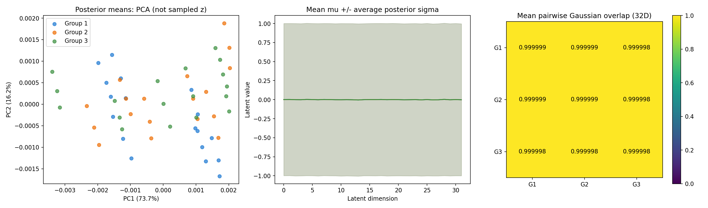
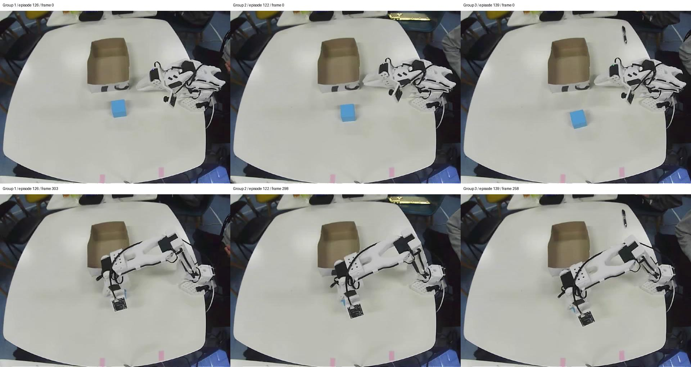

# ACT 不同示范位置的潜在分布对比

模型：200条数据划分为180条训练、20条验证的最佳60k检查点。分析使用原始坐标检查点，与示范坐标保持一致。

采样：限定新增示范的83—142号片段，排除验证集。由场景相机首帧的蓝色方块中心纵坐标划分三组，每组选择6条示范，共18条。每条围绕首次有效闭爪阈值交叉帧取前10帧、交叉帧、后10帧，共54个窗口；每个窗口包含随后100步动作。分组是相机像素位置，不是桌面厘米坐标；方块朝向和操作者轨迹同时存在变化。

方法：使用检查点内置状态和动作归一化，VAE编码器保持eval模式关闭dropout，按源码结构提取32维高斯后验均值与log方差，不运行图像骨干、不连接机械臂。闭爪对齐由动作夹爪通道从45以上向下穿过45且此前120帧内曾超过50确定，属于动作阶段近似对齐。

结果：

- 均值绝对值平均：0.00136794。
- 后验标准差平均：0.99974352。
- 每窗口32维KL总和的平均：0.00007306。
- PCA前两维解释率：89.94%，仅投影后验均值。
- 组间平均Bhattacharyya系数约0.999998，1表示两个高斯分布相同。该值为样本高斯之间系数的平均，不是分类准确率或成功率，组内对角线也按样本对计算。

结论：所选位置组的后验接近标准正态，重叠程度高。潜在分布中的位置区分信号较弱。ACT的视觉与关节状态是另外的条件输入，后验接近标准正态不能单独确定抓空原因，也不能推导模型完全没有位置辨别能力。

文件：`latent_comparison.png`、`positions_and_grasp.jpg`、`metrics.json`、`latents.npz`。复现命令：

```bash
OPENBLAS_NUM_THREADS=1 OMP_NUM_THREADS=2 /home/linx/miniconda3/envs/lerobot/bin/python scripts/analyze_act_latent_positions.py
```

## 对比图




