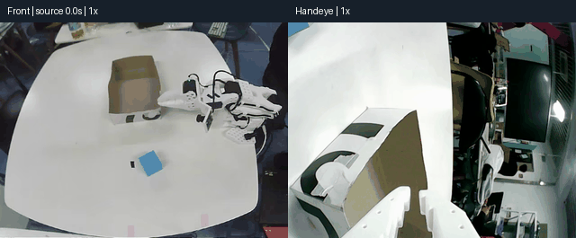
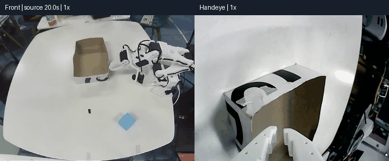

# ACT 蓝色方块抓取放置实验记录

> 实验平台：SO-101 主从机械臂 ｜ 任务：抓取蓝色方块并放入纸盒 ｜ 更新日期：2026-11-09

实验围绕示范采集、ACT 训练、动作执行策略和真机部署展开。

## 1. 实验过程概览

| 阶段 | 数据与配置 | 实际观察 |
|---|---|---|
| 初始示范 | 50条示范，原始记录标注未筛选、示范质量较低 | 可以接近物体，精确抓取不稳定 |
| 固定执行步数对比 | K=15、25、50、75，关闭时间融合 | K=15、25出现初始位置往复动作；K=50、75能够伸展抓取，但存在抖动、反向动作和抓空 |
| 恢复时间集成 | 重叠预测融合 | 姿态与动作连续性改善，仍存在抓空 |
| 扩充数据并筛选 | 200条；180条训练、20条验证 | 局部位置能够完成任务，位置变化后仍有抓取偏差 |

推测原因：

1.ACT是对于示范数据的模仿与学习，示范较脏的时候多余动作和不理想的抓取对于实际运行影响比较大，会导致抓空或者是抓取时候存在歪斜

2.对于固定执行n步的时候由于较小的实际动作导致模型反复回滚，体现在实际表现就是在初始位姿反复颤动。

3.关闭时间集成后对于较长执行步（如32,50,100）等不同预测之前的动作差别比较大，会导致比较严重的卡顿或者抖动

4.较多数据会有效改善抓取成功率，但还是要考虑泛化能力。

## 2. 真机结果

### 2.1 抓取放置片段一

原录像0.0～8.5秒：从初始位置接近方块，闭爪、抬升，移动到纸盒上方并释放。片段结尾可观察放入结果。

### 2.2 抓取放置片段二

原录像20.0～32.5秒：方块在桌面上，机械臂完成接近、抓取、搬运和放入，随后退回。

## 3.后续实验

### 3.1 实验设计

计划使用九宫格划分桌面，并在格子内区分不同位置和抓取角度进行实验，
